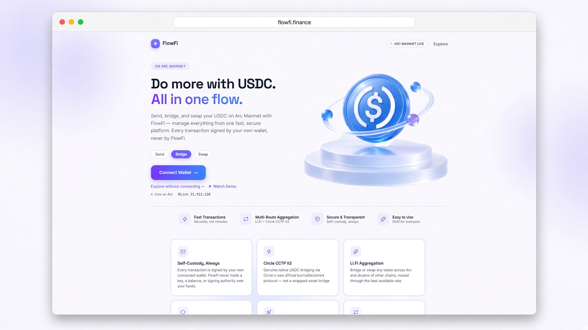
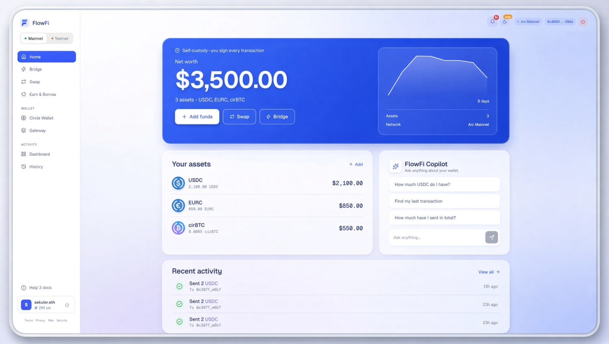
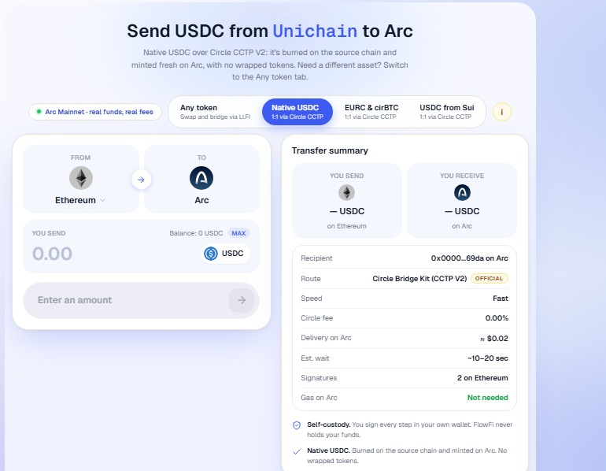
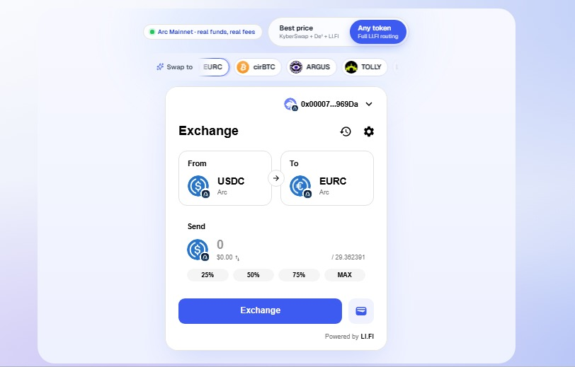
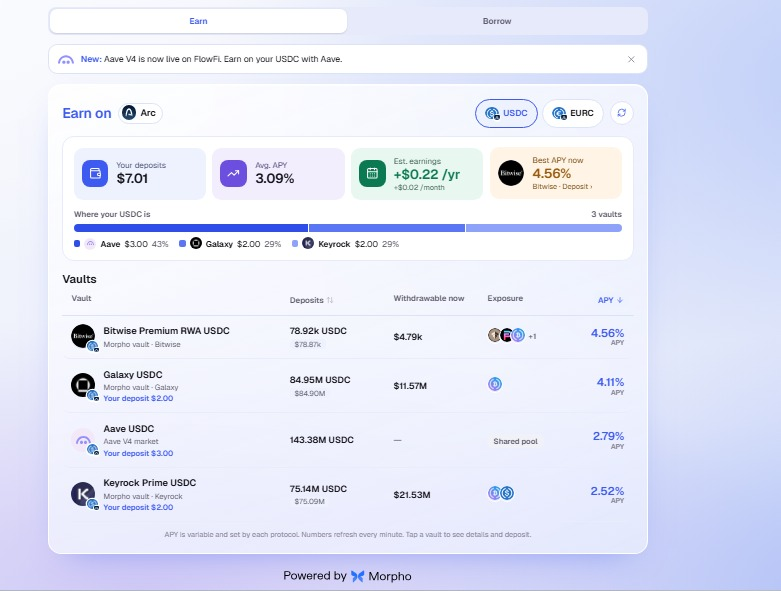
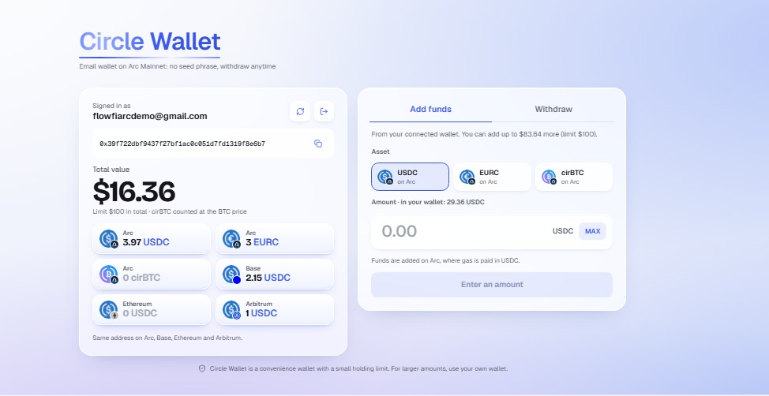
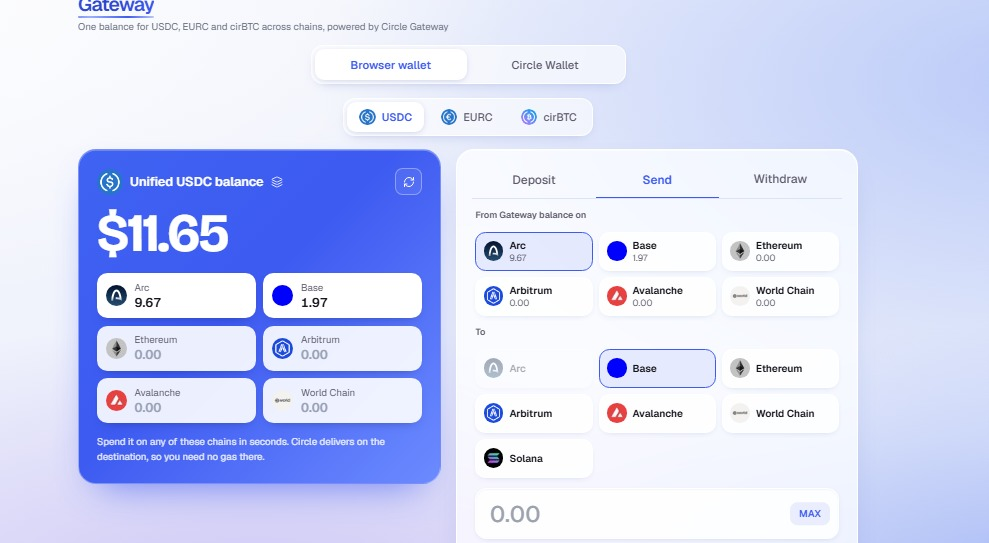
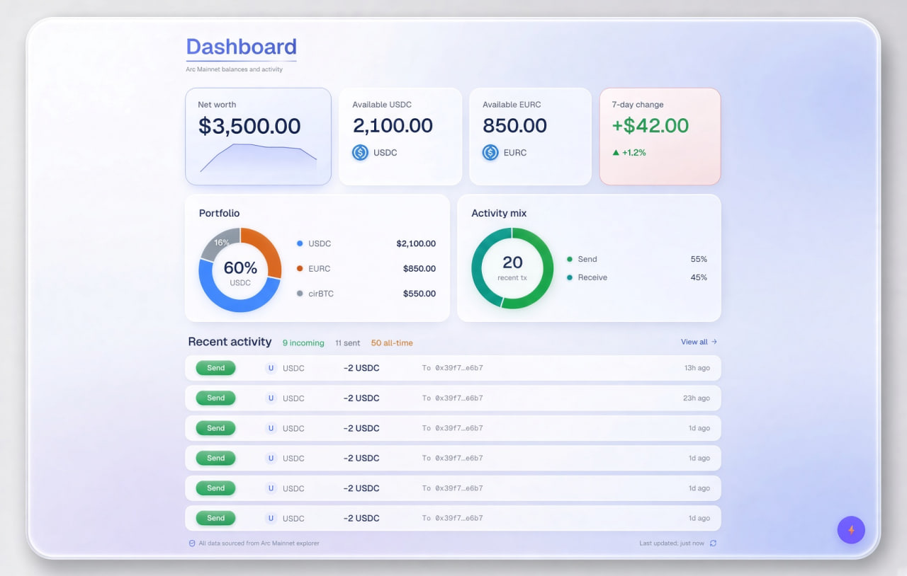
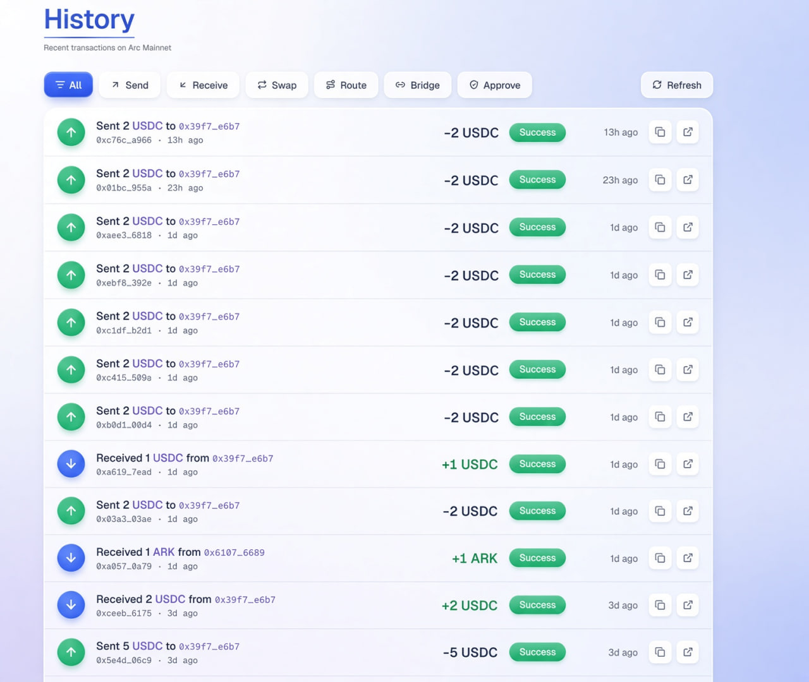

# FlowFi

<p align="center">
  
</p>

Your dollars on Arc, all in one flow. Live on **Arc Mainnet**: native USDC, EURC and cirBTC bridging with Circle's Bridge Kit, USDC from Sui over CCTP V2, one balance for USDC, EURC and cirBTC with Circle Gateway, best-price swaps, and Earn & Borrow on Morpho and Aave.

**App:** [flowfi.finance](https://flowfi.finance) · **Technical walkthrough:** [youtu.be/ECRQsVKIiNM](https://youtu.be/ECRQsVKIiNM) · **Demo:** [youtu.be/Icu8qTiYMqw](https://youtu.be/Icu8qTiYMqw) · **Contracts:** [all addresses](./ADDRESSES.md) · **Repo:** [github.com/sekuler/flowfi](https://github.com/sekuler/flowfi)

| | |
|---|---|
| **Circle Bridge Kit** | Native USDC, EURC and cirBTC to Arc. With Circle's Forwarding Service, Circle completes the mint on Arc, so no Arc gas is needed |
| **USDC from Sui** | Native USDC from Sui to Arc over CCTP V2: burned on Sui, minted on Arc with Circle's attestation |
| **Circle Gateway** | One balance for USDC, EURC and cirBTC across Arc, Base, Ethereum, Arbitrum, Avalanche and World Chain, sendable to any of them (and to Solana) in seconds. Built on Circle's Unified Balance Kit |
| **Circle Wallet** | Email sign-in, no seed phrase. Circle Developer-Controlled Wallets with the same address on Arc, Base, Ethereum and Arbitrum |
| **Swap** | Best price across KyberSwap, De¹ and LI.FI, with the output checked onchain before you sign |
| **Earn & Borrow** | Curated Morpho vaults and the Aave V4 USDC market, compared side by side; borrow USDC or EURC against cirBTC |

[](https://github.com/sekuler/flowfi/actions/workflows/ci.yml)

> **Mainnet runs on established infrastructure.** Every mainnet user flow (bridge, swap, Gateway, Earn & Borrow) runs on Circle, Morpho, Aave, KyberSwap, De¹ and LI.FI contracts that were already live. Users sign every browser-wallet step in their own wallet; FlowFi never holds their funds. See [SECURITY.md](./SECURITY.md) for the trust model.

---

## Live on Arc Mainnet

| Feature | What it does |
|---|---|
| **Home** | Net worth in dollars, the assets held (USDC, EURC, USYC, cirBTC), quick actions for Add funds / Send / Swap / Bridge, an "Ask your wallet" Copilot (read-only), and recent activity in plain language |
| **Send** | Send any token on Arc to another address, signed by the user's own wallet |
| **Bridge: Native USDC** | Circle Bridge Kit (CCTP V2) with Circle's Forwarding Service, from 18 source chains. The user signs only on the source chain; Circle mints native USDC on Arc, so no Arc gas is needed. A transfer interrupted after the burn resumes without burning twice (`MessageTransmitterV2.usedNonces` is checked before any manual mint) |
| **Bridge: EURC & cirBTC** | Circle Bridge Kit: native burn-and-mint, no wrapped tokens. EURC from Ethereum, Base and Avalanche; cirBTC from Ethereum |
| **Bridge: USDC from Sui** | Native USDC from Sui to Arc over CCTP V2: `deposit_for_burn` on Sui, `receiveMessage` on Arc with Circle's attestation |
| **Bridge: Any token** | Any asset onto or off Arc through LI.FI, with route comparison. Supports EVM wallets plus Solana and Bitcoin wallets (Backpack, Phantom, Xverse) |
| **Swap** | Best price on Arc: quotes from KyberSwap, De¹ and LI.FI are compared and the best output is picked, checked onchain before signing. "Any token" mode opens full LI.FI routing |
| **Earn** | USDC: Morpho vaults (Bitwise Premium RWA, Galaxy, Keyrock Prime) and the Aave V4 USDC market. EURC: Morpho vaults (Steakhouse Prime, Gauntlet EURC Prime). Live APY, deposits and withdrawable amount, compared side by side |
| **Borrow** | Borrow USDC or EURC against cirBTC on Morpho Blue markets on Arc. Markets liquidate at 86% LTV; FlowFi caps new borrows and collateral withdrawals at 70% and shows live LTV, liquidation price and borrow rate. Every call is simulated before the wallet opens |
| **Gateway** | One balance for USDC, EURC and cirBTC. Deposit on Arc, Base, Ethereum, Arbitrum, Avalanche or World Chain, then Send or Withdraw to any of them (or to Solana) in seconds with Circle's Forwarding Service, so no gas is needed on the destination. Browser wallets use Circle's Unified Balance Kit; the Circle Wallet deposits on Arc and signs Gateway burn intents server-side, limited to Gateway transfers only |
| **Circle Wallet** | Email sign-in with a one-time code, no seed phrase. Same address on Arc, Base, Ethereum and Arbitrum. Add funds from a browser wallet and withdraw to your own wallet at any time. Actions run through a strict allowlist, with a per-account holding cap |
| **Dashboard** | Net worth, live balances, portfolio split, activity mix and recent activity, read from the chain and Arc's Etherscan-run explorer (`arc.etherscan.io`) |
| **History** | Every transaction and token transfer on the address, including ones made in other apps, with amounts, status and explorer links |
| **AI Copilot (Mainnet)** | Answers questions about balances and activity and points to the right page; it never signs or executes anything itself on mainnet |

The net-worth chart and 7-day change are drawn from daily snapshots saved in the user's own browser (not on a FlowFi server); until enough days have been recorded they say "Not enough history" instead of showing a made-up curve. USD values for EURC, USYC, and cirBTC use live prices; if a price can't be fetched, that token is left out of the dollar total rather than guessed.

### Circle integration in the code

| Circle product | Where |
|---|---|
| Packages | `package.json`: `@circle-fin/adapter-viem-v2`, `@circle-fin/bridge-kit`, `@circle-fin/developer-controlled-wallets`, `@circle-fin/unified-balance-kit` |
| Wallet adapter for the kits | `src/kitAdapter.ts` |
| Bridge Kit + Forwarding Service (USDC) | `src/components/NativeCctpBridge.tsx` |
| Bridge Kit (EURC, cirBTC) | `src/components/NativeEurcBridge.tsx` |
| Unified Balance Kit (Gateway) | `src/components/GatewayMainnet.tsx` |
| CCTP V2 (Sui → Arc) | `src/components/SuiCctpBridge.tsx` |
| Developer-Controlled Wallets | `api/circle-wallet-mainnet.js`, `src/components/CircleWalletMainnet.tsx` |

### Mainnet contracts FlowFi reads or calls

| Contract | Address |
|---|---|
| USDC (ERC-20 interface, 6 decimals) | `0x3600000000000000000000000000000000000000` |
| EURC *(Circle-official)* | `0xbEf5f6d51CB62b58e6A8f77868681825C6fe21c1` |
| USYC | `0x8a5D989Bbb96929F689B0200f435f53dA42bF490` |
| cirBTC *(Circle-official, 8 decimals)* | `0x171A4217b86A807A64eB94757Db6849fb4bDbAA0` |
| CCTP V2 TokenMessengerV2 *(Circle-official)* | `0x28b5a0e9C621a5BadaA536219b3a228C8168cf5d` |
| CCTP V2 MessageTransmitterV2 *(Circle-official)* | `0x81D40F21F12A8F0E3252Bccb954D722d4c464B64` |
| CCTP for non-USDC CrossChainTokenService *(Circle-official)* | `0x431871229103b780868f8C6BB820cd16ECf942BC` |
| Gateway Wallet *(Circle-official)* | `0x77777777Dcc4d5A8B6E418Fd04D8997ef11000eE` |
| Gateway Minter *(Circle-official)* | `0x2222222d7164433c4C09B0b0D809a9b52C04C205` |
| Morpho Blue | `0x34CD04070dD72b14E241112F6d83812Df5Af7fCD` |
| Morpho market cirBTC / USDC (LLTV 86%) | `0xc2db905f174e5defcce01d321b09f15f78856a36a21b90cc7e1abbc29225815d` |
| Morpho market cirBTC / EURC (LLTV 86%) | `0x6ea1ea96a1cc671615f3a3bdf51481c5b79e362a8b634396e680d1070137daf4` |
| Galaxy USDC vault | `0x8E357432CC12ff425c36432F312968aEb16112AF` |
| Keyrock Prime USDC vault | `0x5bEfAb92a5A3D60F578Cb51EEb4e4FD50a1e3123` |
| Steakhouse Prime EURC vault | `0xbeef00be37BdE921BAE06fad223125BAB16c41D1` |
| Gauntlet EURC Prime vault | `0x05863F54B05e96092069eF30c9Ca6060336e50B9` |
| Aave V4 Main Spoke | `0xB843bdC3a87A05E77E07Df9FE48928b3A34b134d` |
| Aave V4 Core Hub | `0x17288dfc86205301064577b98B02b81017e6F79C` |

Morpho market parameters were verified onchain (`idToMarketParams`) and each vault's underlying asset is checked at runtime (`asset()`) before a deposit.

**Bridge routes LI.FI lists for USDC** (LI.FI `/v1/connections`, checked 21 Sep 2026)

| Chain | Arc → chain | chain → Arc |
|---|---|---|
| Base | ✅ | ✅ |
| Ethereum | ✅ | ✅ |
| Arbitrum | ✅ | ✅ |
| Optimism | ✅ | ✅ |
| Polygon | ✅ | ✅ |

A listed connection means LI.FI knows a path for that USDC pair. It does not guarantee liquidity at every amount, and routes can change.

---

## Verified receipts: real transaction hashes

Every claim above is checkable onchain.

**Videos**
- [Technical walkthrough: Circle integrations in the code + live mainnet demo (Oct 2026)](https://youtu.be/ECRQsVKIiNM)
- [FlowFi on Arc Mainnet, full walkthrough (Sept 2026)](https://youtu.be/Icu8qTiYMqw)
- [Native USDC bridge (Base → Arc, CCTP V2 burn & mint)](https://youtu.be/j5hJ95oeA7E)
- [Any-token bridge via LI.FI (Base ETH → Arc USDC)](https://youtu.be/f4Luu0ic3ek)

**Mainnet: Native USDC bridge via Circle CCTP V2 (Base → Arc), 1 USDC, 21 Sep 2026**
| Step | Tx hash |
|---|---|
| Source burn (Base) | [`0x4432dba5df285033b804b26baa583d6bee874ceca209e73b700b8fe53d96a70a`](https://basescan.org/tx/0x4432dba5df285033b804b26baa583d6bee874ceca209e73b700b8fe53d96a70a) |
| Destination mint (Arc) | [`0xf5cf3b1847b5dc8899ae6855a48ff86dfd1031c09343e4d91cee5614e4bef449`](https://arc.etherscan.io/tx/0xf5cf3b1847b5dc8899ae6855a48ff86dfd1031c09343e4d91cee5614e4bef449) |

Standard transfer (Circle destination domain 26).

---

## Why Arc?

FlowFi is designed around stablecoins, not speculation.

CCTP and Circle's wallets work on other EVM chains too. What's Arc-specific is what happens after funds arrive: USDC is Arc's native gas asset, so cross-chain USDC is immediately usable the moment it lands. Users never need ETH or any other gas token; the USDC they hold is both the money they use and the network fee. That removes the biggest first-step barrier for people new to crypto.

FlowFi is built around that arrival point: bridging, swaps, Gateway and Earn & Borrow all settle through the same native-USDC rail, and the Morpho and Aave markets FlowFi uses live on Arc itself.

Arc also runs on Malachite, a consensus engine built for sub-second deterministic finality: once a transaction confirms, it's final.

---

## Architecture

```
┌──────────────────────────────────────────────────┐
│                     Frontend                      │
│             React + TypeScript + viem             │
└───────────────┬──────────────────────┬────────────┘
                │                      │
      ┌─────────▼─────────┐  ┌─────────▼──────────┐
      │  Browser Wallet    │  │   Circle Wallet     │
      │  (EIP-6963, WC)    │  │ email OTP, Vercel   │
      │  user signs        │  │ API + allowlist     │
      └─────────┬─────────┘  └─────────┬──────────┘
                └──────────┬───────────┘
   ┌───────────────────────▼────────────────────────┐
   │ Circle Bridge Kit + Forwarding · CCTP V2 (Sui) · │
   │ Circle Gateway / Unified Balance Kit ·          │
   │ Morpho · Aave V4 · KyberSwap · De¹ · LI.FI      │  ← third-party, already live
   └───────────────────────┬────────────────────────┘
                   ┌───────▼────────┐
                   │   Arc Mainnet   │
                   └────────────────┘
```

---

## Screenshots

| | |
|---|---|
| **Landing**<br>Connect a wallet, sign in with email, or explore |  |
| **Home**<br>Net worth, assets, Copilot, recent activity |  |
| **Bridge**<br>Native USDC, EURC & cirBTC via Circle Bridge Kit, USDC from Sui, any token via LI.FI |  |
| **Swap**<br>Best price across KyberSwap, De¹ and LI.FI |  |
| **Earn & Borrow**<br>Morpho vaults and Aave V4, borrow against cirBTC |  |
| **Circle Wallet**<br>Email sign-in, balances on four chains, add funds / withdraw |  |
| **Gateway**<br>One balance for USDC, EURC and cirBTC across six chains |  |
| **Dashboard**<br>Net worth, portfolio split, activity mix |  |
| **History**<br>Every transaction with status and explorer links |  |

---

## Data sources

FlowFi's market analysis never uses AI-generated numbers. Every figure comes from a real source:

| Data | Source | Notes |
|---|---|---|
| Price, market cap, volume, supply | [CoinGecko](https://coingecko.com) | Free tier |
| RSI, EMA, MACD, support/resistance | Computed server-side | Standard formulas, real historical OHLCV, not AI-generated |
| Mainnet net-worth prices (EUR/USD via EURC, USYC, BTC via cirBTC) | [CoinGecko](https://coingecko.com) | A token with no live price is left out of the dollar total, not guessed |
| Earn APY | Morpho and Aave V4 APIs | Variable, set by each protocol |
| Token unlock/vesting schedules | Live data from the DropsTab API, with a manually curated fallback list cross-checked against [DeFiLlama](https://defillama.com) and official project docs | DropsTab is checked first |

If a data point isn't available from a real source, FlowFi says so rather than guessing.

---

## Tech stack

- **Frontend**: React, TypeScript, Vite
- **Chain interaction**: [viem](https://viem.sh)
- **Wallets**: EIP-6963 (MetaMask, Rabby, etc.), WalletConnect for mobile browsers, Solana and Bitcoin wallets for cross-chain bridging, and Circle Developer-Controlled Wallets with email sign-in
- **Circle**: Bridge Kit, Unified Balance Kit, CCTP V2 (incl. Sui), Forwarding Service, Gateway, Developer-Controlled Wallets, viem adapter
- **Swap & bridge routing**: KyberSwap, De¹, LI.FI
- **Earn & Borrow**: Morpho Blue markets, Morpho vaults (ERC-4626) and Aave V4, called directly with viem
- **AI**: Claude (Anthropic), for plain-language answers and market analysis summaries (never for computing the underlying numbers)
- **Charts**: lightweight-charts
- **Hosting**: Vercel

---

## Running locally

```bash
git clone https://github.com/sekuler/flowfi.git
cd flowfi
npm install

cp .env.example .env
# then fill in:
# ANTHROPIC_API_KEY=       (server-side only — no VITE_ prefix, or it gets bundled into client-side JS)
# CIRCLE_API_KEY=          (Testnet Circle Wallet)
# CIRCLE_ENTITY_SECRET=
# CIRCLE_LIVE_API_KEY=     (Mainnet Circle Wallet, server-side only)
# CIRCLE_LIVE_ENTITY_SECRET=
# WALLET_AUTH_SECRET=      (signs the Testnet Circle Wallet session cookie)
# CIRCLE_LIVE_AUTH_SECRET= (signs the Mainnet Circle Wallet session cookie — must differ from the one above)
# RESEND_API_KEY=          (sends the email sign-in codes)
# VITE_LIFI_API_KEY=       (client-exposed by design, like a publishable key — powers Mainnet Bridge/Swap)
# ETHERSCAN_API_KEY=       (server-side only — powers Mainnet Home/Dashboard/History activity and token-transfer reads via arc.etherscan.io)
# DROPSTAB_API_KEY=        (optional — live token unlock data; falls back to the manual list without it)
# ARC_RPC_URL=             (optional — a keyed RPC provider for Arc Testnet; falls back to the public RPC)
# ARC_MAINNET_RPC_URL=     (optional — falls back to Arc's own public mainnet RPC)
# UPSTASH_REDIS_REST_URL=  (required for Circle Wallet sign-in and for rate limiting on every backend
# UPSTASH_REDIS_REST_TOKEN= endpoint; in production /api/claude, /api/rpc-proxy and /api/upload-image refuse to run without it)

npm run dev
```

Mainnet features work locally against real Arc Mainnet the moment a browser wallet is connected, same as production.

---

## Roadmap

- [x] Circle Bridge Kit + Forwarding Service for USDC, EURC and cirBTC; USDC from Sui over CCTP V2
- [x] Circle Gateway for USDC, EURC and cirBTC across six chains, with browser wallets and Circle Wallet
- [x] Circle Wallet with email sign-in on mainnet
- [x] Best-price swaps and Earn & Borrow on Morpho and Aave V4
- [ ] Bridge Kit support in Circle Wallet: bridge USDC, EURC and cirBTC from Base, Ethereum and Arbitrum to Arc
- [ ] Arc Earn support in Circle Wallet: deposit USDC and EURC into Morpho and Aave vaults, gas paid in USDC
- [ ] Card purchase of USDC in Circle Wallet, delivered straight to Arc
- [ ] Android app with Circle Wallet email sign-in, Gateway, bridging and Earn

**Not on the roadmap:** Perpetuals was fully removed after a security review found no oracle backs the pricing. Token Launch and Liquidity Pools stay testnet-only.

---

## Testnet showcase (legacy)

FlowFi started on Arc Testnet, where its own contracts (Token Launch, Liquidity Pools, Swap) and AI Copilot transaction execution run with test assets that carry no monetary value. That build stays available as a portfolio showcase; active development is on mainnet.

<details>
<summary>Testnet features, contracts and tests</summary>

| Feature | What it does |
|---|---|
| **Circle Wallet (Testnet)** | The original testnet Developer-Controlled Wallet flow |
| **Bridge & Gateway (Testnet)** | CCTP V2 across Arc, Ethereum Sepolia, Base Sepolia and Arbitrum Sepolia; a unified USDC balance via Circle Gateway |
| **Smart Swap** | USDC ⇄ EURC with an AI advisor that reads real pool liquidity and warns before a swap moves the price too much |
| **Permissionless Token Launch** | Deploy your own ERC-20 on Arc and open its own trading pool immediately |
| **Liquidity Pools** | A showcase USDC/EURC pool: add/remove liquidity or swap against it |
| **AI Copilot (Testnet)** | Type what you want ("swap 10 USDC to EURC") and Copilot executes it, signed by the connected wallet |

Every `onlyOwner` testnet contract is owned by a 2-of-3 Safe multisig (`0xa50FFedfC93eDB81F8Bcc23507db8aDdE7EE8Be0`). Superseded versions are documented in [`contracts/LEGACY.md`](./contracts/LEGACY.md).

| Contract (Arc Testnet) | Address |
|---|---|
| Pool Factory v4c | `0xD2dC496dcf4e6D8c9CFc710AC5C9A6Dc941CBbB0` |
| Launch Pool Factory *(only for tokens minted through Token Factory, see [`contracts/README.md`](./contracts/README.md))* | `0x2b3B2E69C14DA2558E3ce6e2d58c04b2147E5ec0` |
| Token Factory (v2) | `0x1Fe800a2663988C043e4a9A393651f18Cd49D998` |
| USDC (Arc Testnet) | `0x3600000000000000000000000000000000000000` |
| EURC | `0x89B50855Aa3bE2F677cD6303Cec089B5F319D72a` |
| CCTP V2 TokenMessengerV2 *(Circle-official)* | `0x8FE6B999Dc680CcFDD5Bf7EB0974218be2542DAA` |
| CCTP V2 MessageTransmitterV2 *(Circle-official)* | `0xE737e5cEBEEBa77EFE34D4aa090756590b1CE275` |
| Gateway Wallet *(Circle-official)* | `0x0077777d7EBA4688BDeF3E311b846F25870A19B9` |
| Gateway Minter *(Circle-official)* | `0x0022222ABE238Cc2C7Bb1f21003F0a260052475B` |

All verified on [Arcscan Testnet](https://testnet.arcscan.app). Escrow v4 is also deployed and verified, see [`contracts/README.md`](./contracts/README.md).

**Testnet receipts**
- CCTP V2 bridge, Ethereum Sepolia → Arc: burn [`0x2920de71…fecc51`](https://sepolia.etherscan.io/tx/0x2920de716bea703082e373d6b711354f6ce4d5076a1783fdb73e0094adfecc51), mint [`0x77a9b887…d61695`](https://testnet.arcscan.app/tx/0x77a9b887dadd47dd6a80d029d8aedee659f730e529ab4a624dd8518226d61695)
- Circle Developer-Controlled Wallet executing a swap on Arc: [`0x0226fc2c…8146c0`](https://testnet.arcscan.app/tx/0x0226fc2c8b4cd4000bd25c6aea358f553aed9e69cc69b36582c0b2c7568146c0)

**Tests.** The testnet contracts have a Foundry test suite covering the fixes documented in [`SECURITY.md`](./SECURITY.md), plus happy-path coverage for each contract. CI ([`.github/workflows/ci.yml`](./.github/workflows/ci.yml)) runs it with a frontend type-check on every push and pull request to `main`.

```bash
curl -L https://foundry.paradigm.xyz | bash
foundryup
forge install foundry-rs/forge-std --no-git --no-commit
forge test -vv
```

FlowFi's testnet contracts have been through a manual security review; design trade-offs from that review are documented in [`SECURITY.md`](./SECURITY.md).

</details>

---

## Legal

- [`TERMS.md`](./TERMS.md): what you're agreeing to by using FlowFi
- [`PRIVACY.md`](./PRIVACY.md): what data is collected, by whom, and why
- [`RISK.md`](./RISK.md): mainnet-specific risks (wrong network, third-party routing, no undo)
- [`SECURITY.md`](./SECURITY.md): the security review and mainnet trust model

These are also linked from the app itself (sidebar footer).

---

## Disclaimer

Arc Mainnet features move real USDC and other assets. Browser-wallet flows are signed by the user's own wallet, at the user's own discretion. The mainnet Circle Wallet is a Circle Developer-Controlled Wallet: FlowFi's backend signs on the user's behalf only for an allowlisted set of actions, holdings are capped, and withdrawals to the user's own wallet are always available. Earn & Borrow use third-party Morpho and Aave markets; rates are variable and borrowing carries liquidation risk. The Testnet showcase runs with test assets that carry no monetary value. See [`TERMS.md`](./TERMS.md), [`PRIVACY.md`](./PRIVACY.md), and [`RISK.md`](./RISK.md) for the full terms.
